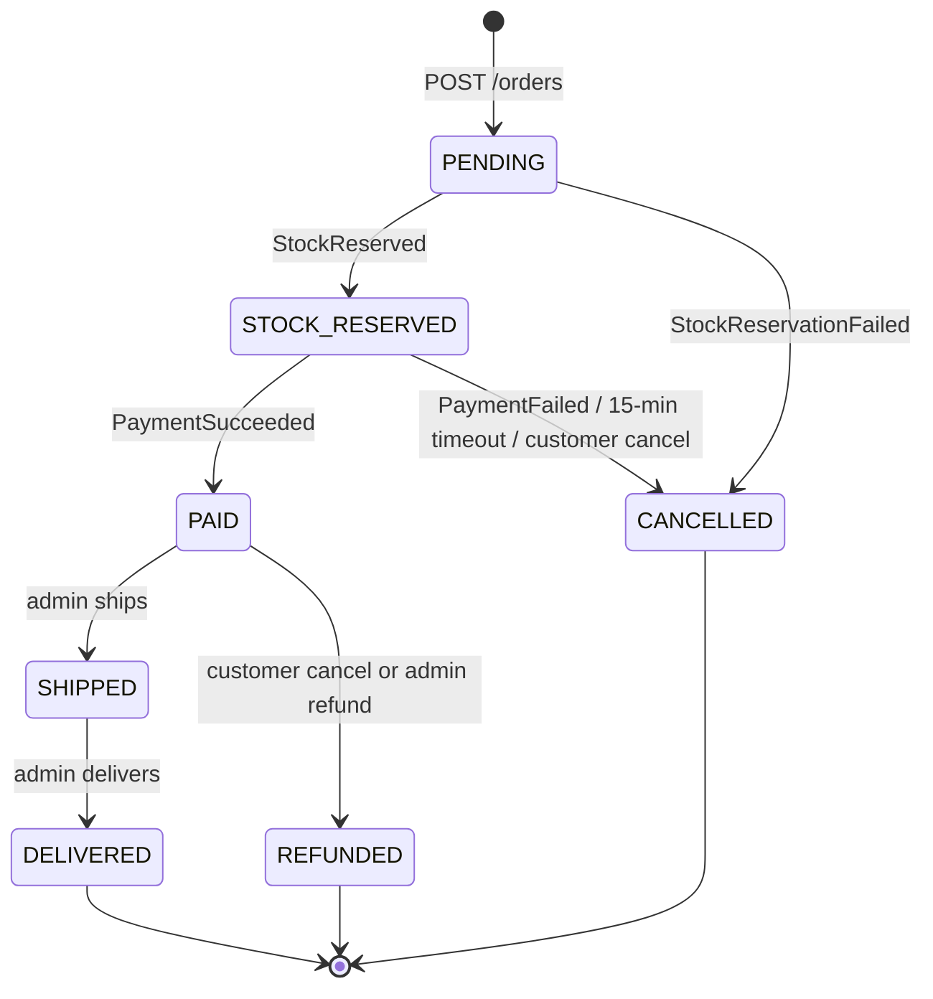
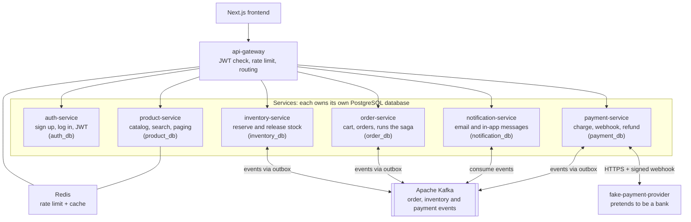
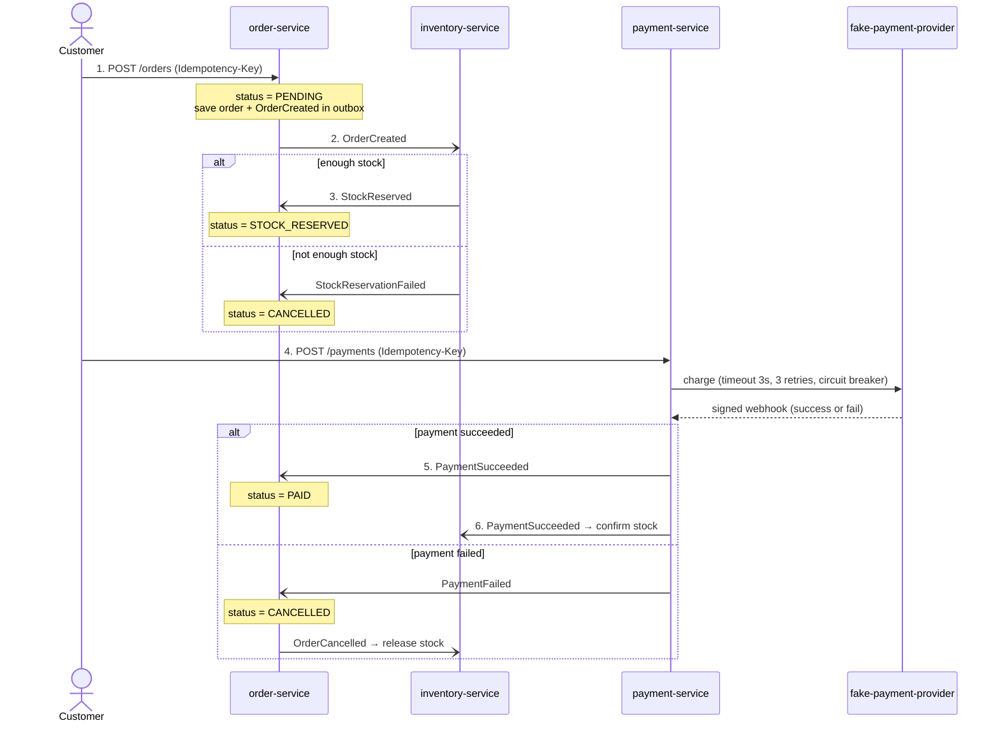

# ShopFlow – Order & Payment Microservices: Requirements and Structure

> **For AI coding agents:** This file is the single source of truth for the ShopFlow project. Follow the requirements (FR-xx, BR-xx, NFR-xx), service boundaries, data model, APIs, events, and folder structure below. Build in the order of the Roadmap. When a choice is not covered here, pick the simplest option that keeps services independent, and note it as a new ADR in `docs/adr/`.

Last updated: 2026-10-16 · Author: Nguyen Van Sang

## Overview

ShopFlow is a small online shop built as 7 microservices. A customer browses products, places an order, pays, and gets a notification. The order and payment flow is the heart of the project.

The goal is not a real business. The goal is to practise and demonstrate skills that day-to-day work does not cover: **Microservices, System Design, Spring Security + JWT, Docker, CI/CD, and AWS**.

**What "done" looks like:**

- One command (`docker compose up`) starts the whole system on a laptop.
- A customer can sign up, log in, order, pay, and see the order status change.
- If payment fails or stock runs out, the system cancels the order and gives stock back. Nothing gets stuck.
- Every push to GitHub runs tests and builds Docker images.
- The system runs on AWS with a public demo link.
- The README and `docs/` folder explain *why* each design choice was made.

## Tech stack and skills it proves

The stack stays close to what you already know (Java, Spring Boot, PostgreSQL, Next.js). New things are added only where they prove a skill.

| Area | Tool | Skill it proves |
| --- | --- | --- |
| Backend | Java 21, Spring Boot 3 | Already strong, the base for everything |
| Service split | 7 Spring Boot services, each with its own database | Microservices, System Design |
| Entry point | Spring Cloud Gateway | Microservices, Security |
| Login and access | Spring Security, JWT (RS256 key pair) | Spring Security, JWT |
| Messages between services | Apache Kafka | System Design (async, events, saga) |
| Database | PostgreSQL (one database per service) | Data design per service |
| Database changes | Flyway | Clean, versioned schema changes |
| Cache | Redis (product list, idempotency keys) | Performance, System Design |
| Retry and fallback | Resilience4j | Reliability |
| Frontend | Next.js, TypeScript, React Hooks | Already strong |
| Containers | Docker, Docker Compose | Docker |
| Pipeline | GitHub Actions | CI/CD |
| Cloud | AWS (ECS Fargate or EC2, RDS, ECR) | AWS |
| Testing | JUnit 5, Mockito, Testcontainers | Testing |
| Monitoring | Spring Boot Actuator, Micrometer, Prometheus, Grafana, Zipkin | Observability |

Note: you can use MyBatis instead of JPA if you want to match your work stack. JPA is more common in job posts, so it may help you more.

## Functional requirements

There are two kinds of users: **Customer** and **Admin**. Each requirement has an ID so you can link it in GitHub issues and commits.

**Customer**

- [ ] FR-01: Sign up with email and password.
- [ ] FR-02: Log in and get an access token (15 min) and a refresh token (7 days).
- [ ] FR-03: Log out. The refresh token stops working.
- [ ] FR-04: See a product list with search, filter by category, and paging.
- [ ] FR-05: See product detail with price and stock left.
- [ ] FR-06: Add, change, and remove items in a cart.
- [ ] FR-07: Place an order from the cart.
- [ ] FR-08: Pay for the order (fake payment provider that can succeed or fail).
- [ ] FR-09: See own orders and the status of each one.
- [ ] FR-10: Cancel an order before it ships. Paid orders get a refund.
- [ ] FR-11: Get a notification (email or in-app) when order status changes.

**Admin**

- [ ] FR-12: Create, edit, and hide products.
- [ ] FR-13: Add stock to a product.
- [ ] FR-14: See all orders and filter by status.
- [ ] FR-15: Mark an order as Shipped and then Delivered.
- [ ] FR-16: Refund a paid order.

**Business rules**

- BR-01: An order can only be placed if all items have enough stock.
- BR-02: Stock is **reserved** when the order is placed and **released** if payment fails or the order is cancelled.
- BR-03: An unpaid order is cancelled automatically after 15 minutes.
- BR-04: A customer can never be charged twice for the same order.
- BR-05: Order price is saved at order time. Later price changes do not affect it.
- BR-06: A customer can only see their own orders. Admin can see all.

**Order status**

`PENDING` → `STOCK_RESERVED` → `PAID` → `SHIPPED` → `DELIVERED`

It can end early as `CANCELLED` (out of stock, payment failed, timeout, or customer cancel) or `REFUNDED`.



## Services

The system has 7 services. Each one owns one part of the business and its own data. No service reads another service's database.

| Service | Port | Owns | Main job | Database |
| --- | --- | --- | --- | --- |
| api-gateway | 8080 | Routing | Single entry point. Checks JWT, rate limits, routes requests. | none |
| auth-service | 8081 | Users, tokens | Sign up, log in, refresh token, roles (CUSTOMER, ADMIN). Publishes the public key for JWT checks. | auth_db |
| product-service | 8082 | Products, categories | Product CRUD, search, paging. Caches product list in Redis. | product_db |
| inventory-service | 8083 | Stock | Reserve, release, and confirm stock. Stops overselling. | inventory_db |
| order-service | 8084 | Cart, orders | Cart, place order, order status, runs the order saga. | order_db |
| payment-service | 8085 | Payments, refunds | Talks to the fake payment provider, handles webhook, refunds. Never charges twice. | payment_db |
| notification-service | 8086 | Notifications | Listens to events and sends email (MailHog locally) or saves in-app messages. | notification_db |

**Helper containers (not services you write):** PostgreSQL, Kafka, Redis, MailHog (fake email inbox), Zipkin, Prometheus, Grafana, and **fake-payment-provider**. The fake provider is a tiny app that pretends to be a bank. It succeeds about 80% of the time, fails about 20%, and sometimes is slow, so you can test failure cases.

**Why order-service holds the cart:** the cart is only used to build an order, so a separate cart-service would add network calls without a real benefit. Write this down as an ADR.

## System architecture

The browser only talks to the gateway. Services never call each other's databases, and most service-to-service work goes through Kafka events, not direct calls.



**Communication rules**

- **Outside → inside:** always through api-gateway over REST.
- **Service → service:** use Kafka events by default. A direct REST call is allowed only when you need an answer right now (none are needed in the main flow).
- **Service → its data:** each service only touches its own database.
- **Payment → bank:** payment-service calls the fake provider over HTTPS. The provider answers later through a signed webhook.
- **Monitoring** (Zipkin, Prometheus, Grafana) watches every service and is left out of the picture to keep it clear.

## Main flow: place order and pay

The order flow is a **choreography saga**: each service does its step and sends an event, and the next service reacts. There is no single "boss" service. notification-service listens to every event and is left out of the picture.

Key idea: stock is reserved before payment, so a paid order always has its items.



**When something goes wrong**

| What fails | What the system does | Final status |
| --- | --- | --- |
| Not enough stock (step 3) | inventory sends StockReservationFailed. order cancels the order. | CANCELLED |
| Payment fails (step 5) | payment sends PaymentFailed. order cancels and sends OrderCancelled. inventory releases the stock. | CANCELLED |
| Customer never pays | After 15 minutes a job cancels the order and sends OrderCancelled. inventory releases the stock. | CANCELLED |
| Fake bank is slow or down | 3 retries with backoff, then the circuit breaker opens and payment is marked failed. Same as "payment fails". | CANCELLED |
| Customer cancels a paid order | order sends OrderCancelled. payment refunds and sends PaymentRefunded. inventory returns the stock. | REFUNDED |
| Same event arrives twice | The receiver finds the eventId in processed_events and skips it. | No change |

The big idea: every step that changes something has a matching **undo step** (called a compensating action). Reserve has release, charge has refund. This is how microservices stay correct without one big database transaction.

## Data model

Each service has its own tables. When one service needs data from another, it saves a copy of only what it needs (for example, order_items saves product name and price at order time). All money is stored as `BIGINT` in the smallest unit (VND has no decimals, so 150000 = 150,000 VND).

| Service | Table | Main columns |
| --- | --- | --- |
| auth | users | id, email (unique), password_hash, full_name, role, created_at |
| auth | refresh_tokens | id, user_id, token_hash, expires_at, revoked |
| product | categories | id, name, slug |
| product | products | id, category_id, name, description, price, image_url, active, created_at, updated_at |
| inventory | stock | product_id (PK), available, reserved, version |
| inventory | reservations | id, order_id, product_id, quantity, status (RESERVED, CONFIRMED, RELEASED), expires_at |
| order | carts | id, user_id (unique), updated_at |
| order | cart_items | cart_id, product_id, quantity |
| order | orders | id, user_id, status, total_amount, currency, idempotency_key (unique per user), created_at, updated_at, version |
| order | order_items | id, order_id, product_id, product_name, unit_price, quantity |
| order | order_status_history | id, order_id, from_status, to_status, reason, changed_at |
| payment | payments | id, order_id (unique), amount, status (PENDING, SUCCEEDED, FAILED, REFUNDED), provider_ref, idempotency_key (unique per user), created_at |
| payment | refunds | id, payment_id, amount, status, created_at |
| notification | notifications | id, user_id, type, title, body, read, created_at |
| every service that sends events | outbox | id, aggregate_id, event_type, payload (JSONB), created_at, sent_at |
| every service that receives events | processed_events | event_id (PK), processed_at |

**Key points to notice:**

- `stock.version` and `orders.version` use **optimistic locking**. Two people buying the last item at the same time cannot both win.
- `payments.order_id` is unique. The database itself blocks a second payment for the same order (BR-04).
- `outbox` and `processed_events` make events safe. See the Non-functional requirements section.

## APIs and events

All public APIs go through the gateway at `/api/v1/...`. Every service also has `/actuator/health`. Errors use one shared format (RFC 7807 Problem Details).

**REST APIs**

| Method | Path | Service | Who | Req |
| --- | --- | --- | --- | --- |
| POST | /auth/register | auth | Public | FR-01 |
| POST | /auth/login | auth | Public | FR-02 |
| POST | /auth/refresh | auth | Public | FR-02 |
| POST | /auth/logout | auth | Customer | FR-03 |
| GET | /.well-known/jwks.json | auth | Gateway only | FR-02 |
| GET | /products?q=&category=&page=&size= | product | Public | FR-04 |
| GET | /products/{id} | product | Public | FR-05 |
| POST / PUT / DELETE | /admin/products/{id} | product | Admin | FR-12 |
| POST | /admin/inventory/{productId}/add | inventory | Admin | FR-13 |
| GET / PUT / DELETE | /cart/items/{productId} | order | Customer | FR-06 |
| POST | /orders (header: Idempotency-Key) | order | Customer | FR-07 |
| GET | /orders, /orders/{id} | order | Customer | FR-09 |
| POST | /orders/{id}/cancel | order | Customer | FR-10 |
| POST | /payments (header: Idempotency-Key) | payment | Customer | FR-08 |
| POST | /payments/webhook | payment | Fake provider (signed) | FR-08 |
| GET | /admin/orders?status= | order | Admin | FR-14 |
| POST | /admin/orders/{id}/ship, /deliver | order | Admin | FR-15 |
| POST | /admin/payments/{id}/refund | payment | Admin | FR-16 |
| GET | /notifications | notification | Customer | FR-11 |

**Kafka events**

Every event has the same envelope: `eventId`, `eventType`, `occurredAt`, `orderId`, `payload`. The key is `orderId`, so all events for one order stay in order.

| Topic | Event | Sent by | Read by |
| --- | --- | --- | --- |
| order-events | OrderCreated | order | inventory, notification |
| order-events | OrderCancelled | order | inventory, payment, notification |
| order-events | OrderShipped, OrderDelivered | order | notification |
| inventory-events | StockReserved | inventory | order |
| inventory-events | StockReservationFailed | inventory | order |
| payment-events | PaymentSucceeded | payment | order, inventory, notification |
| payment-events | PaymentFailed | payment | order, notification |
| payment-events | PaymentRefunded | payment | order, notification |

Each topic also has a dead letter topic (for example `order-events.DLT`). Messages that fail 3 times go there so they don't block the line.

## Non-functional requirements

This section is where the System Design skill really shows. Each item answers "what happens when something goes wrong?"

**Security**

- NFR-01: Passwords are hashed with BCrypt.
- NFR-02: auth-service signs JWT with a private key (RS256). Other services only need the public key from `/.well-known/jwks.json`. No shared secret is copied around.
- NFR-03: The gateway checks the token and passes `X-User-Id` and `X-User-Role` to services. Services also check roles with `@PreAuthorize` (defense in depth).
- NFR-04: Refresh tokens are stored as a hash and are rotated on each use.
- NFR-05: Login is rate limited (5 tries per minute per IP) using Redis at the gateway.
- NFR-06: The payment webhook checks an HMAC signature. Fake calls are rejected.
- NFR-07: Secrets come from environment variables locally and AWS Secrets Manager in the cloud. Never in Git.

**Reliability**

- NFR-08: **Transactional outbox.** A service saves its data and the event in the same database transaction. A small job then sends the event to Kafka. So data and events never disagree.
- NFR-09: **Idempotent consumers.** Each service saves `eventId` in `processed_events`. The same event arriving twice is ignored.
- NFR-10: **Idempotent APIs.** `POST /orders` and `POST /payments` need an `Idempotency-Key` header. Pressing "Pay" twice charges once.
- NFR-11: Calls to the fake provider have a 3 s timeout, 3 retries with backoff, and a circuit breaker (Resilience4j).
- NFR-12: A scheduled job cancels unpaid orders after 15 minutes and releases expired stock reservations.
- NFR-13: If notification-service is down, orders and payments still work. Messages wait in Kafka.

**Performance**

- NFR-14: Product list p95 response under 200 ms with Redis cache (cache cleared when a product changes).
- NFR-15: Place-order API returns in under 500 ms. The rest of the flow happens in the background.
- NFR-16: Add database indexes for every common search (orders by user_id + created_at, orders by status).
- NFR-17: Load test with k6: 100 users placing orders for 5 minutes with no overselling and no double charge.

**Observability**

- NFR-18: Every request gets a trace ID that follows it across all services and Kafka (Micrometer Tracing + Zipkin).
- NFR-19: Logs are JSON and include the trace ID, so you can search one order's full story.
- NFR-20: Grafana dashboard shows request rate, error rate, response time, and orders per status.

## Repository structure

Use one GitHub repo (monorepo) with a Maven multi-module build. It is easier to manage alone, and a reviewer sees everything in one place. Write down why in an ADR.

```
shopflow/
├── README.md                 # what it is, diagram, how to run, demo link
├── docker-compose.yml        # whole system on one laptop
├── pom.xml                   # parent Maven build
├── docs/
│   ├── architecture.md
│   ├── adr/                  # 0001-use-microservices.md, 0002-...
│   └── diagrams/
├── libs/
│   └── common/               # event envelope, error format, outbox, security helpers
├── services/
│   ├── api-gateway/
│   ├── auth-service/
│   ├── product-service/
│   ├── inventory-service/
│   ├── order-service/
│   ├── payment-service/
│   └── notification-service/
├── tools/
│   └── fake-payment-provider/
├── frontend/                 # Next.js + TypeScript
├── infra/
│   ├── aws/                  # Terraform or AWS CDK (optional)
│   ├── grafana/
│   └── prometheus/
├── load-test/                # k6 scripts
└── .github/workflows/        # ci.yml, deploy.yml
```

**Inside one service (example: order-service)**

Use a simple layered style, grouped by feature:

```
order-service/src/main/java/com/shopflow/order/
├── OrderServiceApplication.java
├── api/          # controllers, request/response DTOs
├── domain/       # Order, OrderItem, OrderStatus, business rules
├── service/      # OrderService, CartService, OrderSaga
├── repository/   # JPA or MyBatis
├── messaging/    # Kafka listeners, outbox publisher
├── client/       # calls to other services (if any)
└── config/       # security, Kafka, Resilience4j
src/main/resources/
├── application.yml
└── db/migration/ # Flyway: V1__init.sql, V2__...
```

Keep `libs/common` small. If it grows too big, services become tied together again, which breaks the point of microservices.

## DevOps: Docker, CI/CD, AWS

**Docker**

- Each service has a multi-stage Dockerfile: build with Maven, run on a small JRE image, run as a non-root user.
- `docker-compose.yml` starts all services plus PostgreSQL, Kafka (KRaft mode, no Zookeeper), Redis, MailHog, Zipkin, Prometheus, and Grafana.
- Every container has a health check, and services wait for their database and Kafka to be healthy.

**CI/CD with GitHub Actions**

1. On every pull request: build, run unit tests, run integration tests with Testcontainers, check code style.
2. Only build services that changed (path filters), so the pipeline stays fast.
3. On merge to `main`: build Docker images, tag them with the Git commit SHA, push to Amazon ECR.
4. Deploy to AWS automatically, then run a simple smoke test (call `/actuator/health` on each service).
5. Use GitHub OIDC to log in to AWS. No AWS keys stored in GitHub.

**AWS (keep it cheap)**

| Option | What runs where | Cost | Good for |
| --- | --- | --- | --- |
| A. Simple | One EC2 instance running docker compose, RDS PostgreSQL free tier | Low, some free tier | Getting online fast |
| B. Production-like | ECS Fargate (one task per service), RDS, ElastiCache, Amazon MSK or Kafka on EC2, ALB in front | Higher | Showing real cloud skills |

Start with option A. Move to option B later and write an ADR about the change.

Turn off resources when you are not using them, and set an AWS Budget alert (for example 10 USD) so you never get a surprise bill. The frontend can go on Vercel or S3 + CloudFront.

## Testing

Aim for about 70% line coverage on business logic (domain and service layers). Don't chase 100%. Test the risky parts well.

| Level | Tool | What to test |
| --- | --- | --- |
| Unit | JUnit 5, Mockito | Order status rules, price total, stock math, token creation |
| Integration | Testcontainers (PostgreSQL, Kafka, Redis) | Repositories, outbox publishing, Kafka listeners, Flyway scripts |
| API | Spring MockMvc / WebTestClient | Controllers, security rules (customer can't see another user's order) |
| Contract | Spring Cloud Contract (optional) | Event shapes stay the same between sender and receiver |
| End-to-end | REST Assured or Playwright | Full flow through the gateway: register → order → pay → delivered |
| Load | k6 | 100 users ordering at once: no overselling, no double charge |

**Must-have test cases (these prove System Design):**

- [ ] Two customers buy the last item at the same time. Only one order succeeds.
- [ ] The same Kafka event is delivered twice. It is processed once.
- [ ] The user clicks "Pay" twice with the same Idempotency-Key. One payment only.
- [ ] The fake provider times out. Retries happen, then the order is cancelled and stock is released.
- [ ] notification-service is stopped during an order. The order still completes, and the email arrives after the service restarts.
- [ ] An unpaid order is cancelled after 15 minutes.

## Design decisions (ADRs)

Write each one as a short file in `docs/adr/`. Each ADR has 4 parts: **Context** (the problem), **Options** (2–3 choices), **Decision** (what you picked), and **Consequences** (good and bad results). Half a page each is enough.

| # | Decision | Main trade-off to explain |
| --- | --- | --- |
| 0001 | Split into 7 services by business area | More moving parts vs. independent deploy and scale |
| 0002 | One database per service | No cross-service joins vs. loose coupling |
| 0003 | Choreography saga with Kafka (no central orchestrator) | Simpler for 4 steps vs. harder to see the whole flow |
| 0004 | Transactional outbox for events | Extra table and job vs. no lost or ghost events |
| 0005 | Reserve stock before payment | Stock is held for 15 min vs. no paying for items you can't get |
| 0006 | JWT with RS256 and JWKS, checked at the gateway | Can't instantly kill an access token vs. no call to auth on every request |
| 0007 | Cart lives in order-service | Less separation vs. fewer network calls |
| 0008 | Monorepo with Maven modules | One big repo vs. easy for one developer |
| 0009 | Kafka over RabbitMQ | Heavier to run vs. replay, ordering by key, common in job posts |
| 0010 | Start on EC2, move to ECS Fargate | Cheap and fast first vs. a real cloud setup later |

If you change your mind later, don't delete the old ADR. Mark it "Replaced by 00XX". The history shows how the thinking changed.

## Roadmap

About 10–12 weeks if you work 8–10 hours a week. Each phase ends with something that works, so you can stop at any phase and still have a project to show.

1. **Phase 1 – Base (week 1–2):** monorepo, parent pom, `libs/common`, docker-compose with PostgreSQL. product-service with CRUD, paging, Flyway, unit tests.
   - Done when: `docker compose up` and product APIs work.
2. **Phase 2 – Security (week 3):** auth-service (register, login, refresh, logout), RS256 JWT, JWKS. api-gateway checks tokens and roles.
   - Done when: a customer can't call admin APIs.
3. **Phase 3 – Order flow (week 4–6):** inventory-service, order-service with cart, Kafka, outbox, processed_events. Saga for order → stock reserve.
   - Done when: placing an order reserves stock, and out-of-stock cancels it.
4. **Phase 4 – Payment (week 7–8):** payment-service, fake-payment-provider, webhook with HMAC, Idempotency-Key, Resilience4j, refunds, 15-min timeout job.
   - Done when: all 6 must-have test cases pass.
5. **Phase 5 – Notifications and frontend (week 9):** notification-service with MailHog. Next.js pages: login, products, cart, checkout, my orders, admin orders.
   - Done when: the full flow works in a browser.
6. **Phase 6 – CI/CD and AWS (week 10–11):** GitHub Actions, ECR, deploy to EC2 (option A), budget alert, demo link in README.
   - Done when: a push to `main` updates the live demo.
7. **Phase 7 – Polish (week 12):** Zipkin, Prometheus, Grafana dashboard, k6 load test, finish ADRs, architecture diagram, a 2-minute demo video.
   - Done when: a stranger can understand the project from the README alone.

**After that (optional):** move to ECS Fargate, add an AI feature (for example "find my orders from last week that are not delivered" in plain words), or add a real payment sandbox (Stripe test mode or VNPay sandbox).
